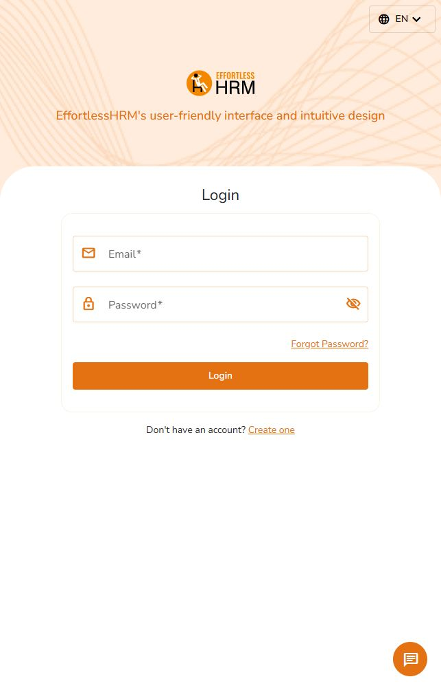
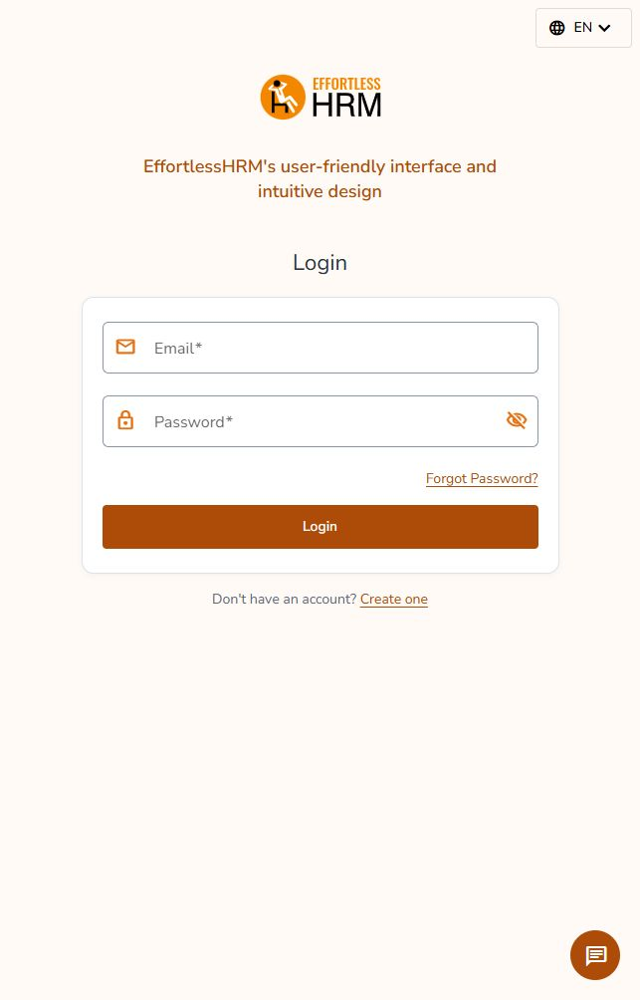

# EffortlessHRM visual refresh — 25 October 2026

## Status

Implemented a shared visual refresh and targeted screen improvements in the existing Angular application. **This is not a completed page-by-page product sign-off.** Authenticated screens still need visual and interaction testing with safe role accounts. The user explicitly chose source review and public screens rather than providing a test session.

## Direction and references

Keep the existing logo, orange and green identity, Nunito Sans, Angular 17, Material and Bootstrap. Use warm navigation accents, a neutral work canvas, white surfaces, restrained borders, compact headings and stable controls. Darker orange/green action shades support readable white labels; the original brand orange remains in artwork and accents.

Official references actually read:

- [Personio Core HR](https://www.personio.com/product/core-hr-software/): task-oriented grouping of people, time, documents and reporting. Applied the principle of clear section hierarchy, without changing our routes or feature grouping.
- [Gusto employee self-service](https://gusto.com/product/payroll/employee-self-serve): direct access to an employee's existing information and everyday actions.
- [Gusto employee management component documentation](https://sdk.gusto.com/docs/reference/employee/management/blocks/): tabbed detail sections, distinct read/edit surfaces and explicit feedback. Useful support for keeping existing profile tabs and form workflows, with consistent presentation.

Research was limited to public product content and documentation, not authenticated competitor tours or a full screenshot study. BambooHR pages attempted were unavailable. No competitor assets or wording were copied.

## Changes

- Added shared color, surface, border, radius, elevation, motion and focus tokens; retained the existing spacing scale.
- Harmonized Material action colors and Bootstrap workspace controls. Improved input borders, semantic action colors, dialogs, expansion panels, menus, notifications and reduced-motion handling.
- Reworked the shell as a viewport-height flex layout so a wrapping header does not push the drawer below the viewport. Retained mobile overlay navigation and the drawer width observer.
- Replaced sidebar clickable list items with real links; preserved each binding, destination and active condition. Added a navigation landmark and skip-to-content link.
- Made the account trigger a keyboard-operable button, with named navigation, photo and notification controls.
- Refined the shared table toolbar, headers, rows, empty state and scroll region. Named search, selection and row-action controls. Sorting, pagination, selection and export handlers are unchanged.
- Made the shared CRUD form fluid and associated its text/date/select labels. Styled existing validation feedback.
- Reworked login, registration and recovery layout with a bounded form column and no fixed top spacer; retained artwork. Improved password toggle names, password-manager autocomplete, logo alternatives and login error announcements. Refined the change-password layout and fixed label associations.
- Improved admin/user dashboard card breakpoints and chart legend readability. Attendance summaries now use restrained accents. Attendance text has a 12px floor rather than shrinking to 4–8px; calendar tables scroll with usable column widths.
- Kept profile section tabs shrinkable and named the employee back action. Fixed the live-screen grid minimum width on narrow screens.
- Added 86 accessible names across 71 additional templates for existing icon-only actions, mostly close-dialog and more-actions buttons. See `icon-labels.csv`.
- Made the chat launcher a named native button with expanded state; named message/voice controls and a live message log; fixed narrow input sizing and long-message wrapping.
- Converted public navigation and timesheet export actions to native buttons while preserving handlers. Mobile navigation opens by keyboard and restores focus after Escape.
- Fixed 320px landing overflow by wrapping footer social links; named those links. Scoped landing section spacing to its own page.
- Improved public feedback form width, dynamic field names and keyboard rating controls; removed helpdesk toolbar overlap and raised task-count text from 9px to 12px.
- Resolved five externally introduced asset-management merge conflicts at the user's request, preserving current validation/custom fields and incoming report/panel behavior. No unmerged files remain.

The redesign leaves routes, dependencies, services, calculations, permissions and API contracts unchanged. Test TypeScript was repaired. Production TypeScript changed only in the separately authorized asset-management conflict resolution; see `ASSET_MERGE.md`. Payslip capture dimensions and existing table scroll wrappers remain in place.

## Coverage checklist

- [x] Inspect clean working tree, architecture, theme, shell, routes and previous responsive review. No applicable AGENTS.md found.
- [x] Inventory the original 332 HTML templates (333 after the incoming asset-report template) and route declarations: `template-inventory.csv`, `route-inventory.txt`.
- [x] Source-review and improve shared navigation, header, table, CRUD/form controls and account screens.
- [x] Source-review dashboard, attendance overview, employee-profile sections and representative leave form.
- [x] Structural sweep across feature templates for tables, forms, dialogs, tiny inline text, fixed widths and unnamed icon buttons.
- [x] Apply shared styling through the workspace and Material overlays.
- [x] Browser-review login, registration, password recovery, landing/mobile navigation, chat and the change-password form.
- [x] Additional source review of public feedback, helpdesk toolbar, timesheet export/scroll controls and asset-management merge.
- [ ] Individually review every authenticated page and significant state with realistic safe data. Inventory coverage is not a claim of individual visual review.
- [ ] Exercise all role-specific workflows, charts, menus, dialogs, exports, filters, sorting and pagination in a running authenticated session.
- [ ] Complete 200% browser zoom, screen-reader and full WCAG 2.2 AA audit.

Feature inventory includes alerts, approvals, attendance, calendar, dashboard, expenses, feedback, helpdesk, interviews, leave, logs, manage/profile, manual time, organization/assets, payroll/F&F, permissions/roles, realtime/screenshots, reports, separation, settings, subscriptions, taxation, timesheets, tasks, landing and account pages. Shared improvements apply to these surfaces where they use the existing controls; specialized screens retain their existing composition.

## Verification

- `npm run build -- --configuration=development`: passed after continuation and asset merge, hash `7cfac6f361f36e10`; see `build-continuation.log`. Existing CommonJS and autoprefixer warnings remain.
- Repaired seven stale test-compilation issues. Focused tests: **11 passed** (`tests-focused.log`), plus **4 asset-merge regression tests passed** (`tests-asset-merge.log`). No tests were disabled and no schemas were added to suppress errors.
- Final full suite: **34 passed, 103 failed, 137 total** (`tests-final.log`). Of the remaining failures, 80 first report missing providers, 19 invalid test-module configuration, and four other errors. `test-failures.json` lists each failure. The earlier compile-only failure is retained in `tests.log`; the suite is still not green.
- No lint script or Angular lint target is configured. No lint check claimed.
- `node docs/design/verify-template-contracts.cjs`: passed; 1,202 existing event/form/route bindings preserved across 94 modified templates. This is a source guard, not an end-to-end behavior test.
- `git diff --check` and `git diff --cached --check`: passed; `git ls-files -u` is empty.
- Final login, registration, password recovery and landing checks at 320, 390, 430, 768, 1024, 1440 and 1920 CSS pixels: all 28 checks have no page-level horizontal overflow or completed broken images. See `public-responsive-final.json`. Landing was rechecked at 320px after the footer fix (312px document width).
- Login visually inspected at phone, tablet and desktop widths; short 430×400 viewport remains vertically scrollable. Registration and recovery inspected at phone widths; change-password at 390px. Browser automation became intermittently unavailable during later navigation; remaining public-page checks and zoom checks are not claimed.
- Empty login submission showed both field errors and the existing summary message without calling login. Password visibility changed its accessible name and pressed state. Recovery navigation and language-menu open/Escape dismissal worked. Registration blur validation displayed the required first-name error. No OTP, recovery email, account creation, password change or HR action was submitted.
- Keyboard navigation was inspected on login/registration. Material focused fields show their focused border; named toggles and additional focus outlines are implemented. No complete assistive-technology audit performed.
- Computed token contrast against white: orange action 5.51:1; green action 5.03:1; muted text 5.78:1; main text 12.86:1; danger 6.51:1; focus/info 6.97:1; control border 3.05:1. These checks do not certify all legacy page colors.
- Browser console reported failed preference-structure requests to the local backend. No claim of a clean runtime console or successful authenticated API integration.

## Screenshots

Both captures use a 643×1004 viewport and contain only the public login screen.

| Before | After |
| --- | --- |
|  |  |

## Remaining limitations

Authenticated screenshots, populated dashboard/list/form visual validation, permission checks and actual data operations were unavailable without a test session. Reset-password requires a valid test token. Public feedback fields depend on backend configuration; their labels/rating controls received source review, not populated browser validation. Third-party enquiry submission was not exercised. The incoming asset-report page remains a placeholder. Source review found the existing feedback Boolean block checks `FieldType.Date`; it was not changed because that alters field-rendering logic beyond the visual work. The full page-by-page review remains outstanding; the inventory deliberately marks that distinction. New generic accessible names follow existing English shared controls; translation expansion remains to be reviewed. Existing legacy CSS and unmodified local overrides still require visual validation before release.

## Continuation evidence

- `public-responsive-final.json`: 28 responsive measurements.
- `screenshots/login-final.png`, `register-mobile.png`, `recovery-mobile.png`, `landing-mobile.png`, `navigation-mobile.png`, `chat-320.png`.
- `ASSET_MERGE.md`: exact conflict-resolution scope and regression evidence.
- No authenticated account was available; the user reconfirmed continuing with source and public checks only. Full page-by-page authenticated review remains a release prerequisite, not a completed deliverable.
